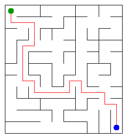

# Assignment 3. Maze Escape

Student ID: 250322
Name: Yasmina
Group: SE-2532

This file is the report. Fill it in as you go. How to start: `START_HERE.md`. The task: `docs/Assignment3.pdf`.

## Program output

The 13 lines your program prints on your data (`java -cp out Main`):

    Broken: 189
    Kept: 90
    Last broken wall: 150
    MST cost: 32058
    Heaviest broken wall: 866
    Path length: 23
    DFS visited: 76
    Dead ends: 32
    Zones: 11
    Largest zone: 15
    Is DAG: 0
    Flow stages: 6
    Fastest route cost: 26

My maze:

## Questions

Answer in your own words, two or three sentences each.

Mission 0. What do find and union do, and what makes them fast in your code?
`find` determines which subset a particular element is in and returns the representative root of that set, while `union` merges two separate subsets into a single set. They are exceptionally fast in our code because we use path compression during `find` (making future lookups nearly constant time) and union-by-size to keep the tree shallow.

Mission 1. Why is Broken always R*C - 1, and Kept always (R-1)*(C-1)?
A maze generated as a spanning tree on $R \times C$ cells always requires exactly $R \times C - 1$ edges (broken walls) to connect all cells without any cycles. Since a grid graph with $R$ rows and $C$ columns has $(R-1)C + R(C-1)$ total internal walls, subtracting the broken walls leaves exactly $(R-1)(C-1)$ walls kept.

Mission 2. My MST cost from Kruskal and from Prim, and why they are equal:
The total Minimum Spanning Tree cost is 32058 for both algorithms. They are equal because both Kruskal's and Prim's algorithms are proven greedy methods that find the optimal minimum spanning tree for a connected weighted graph.

Mission 3. Why is there exactly one path between two cells? How did you avoid a stack overflow on a huge maze?
A maze is structurally a tree (a connected acyclic graph), meaning there is exactly one simple path between any pair of cells. To prevent stack overflow on huge mazes like $1000 \times 1000$, we implemented an iterative DFS using an explicit `ArrayDeque` stack instead of recursive function calls.

Mission 4. Why does the second pass of Kosaraju go on the reversed graph? Why do the slides have no cycle exactly when Zones equals the number of cells?
The second pass runs on the reversed graph to isolate strongly connected components (SCCs) by restricting reachability from the vertices finished last in the first pass. When the number of zones equals the number of cells, every SCC contains only a single vertex, meaning there are no directed cycles anywhere in the graph.

Mission 5. Why is it enough to go through the zones in the order of their numbers? What does this pass cost?
Processing zones in their zone numbers order guarantees a valid topological sort, meaning all directed edges only point from smaller zone numbers to larger ones. This allows dynamic programming in linear time, costing $O(V_{zones} + E_{zones})$ operations.

## AI use

Used Gemini as a personal AI collaborator and assistant to help structure the code, resolve algorithmic nuances for DFS visited tracking, review implementation logic, and format the README report.

## Timing (Mission 7)

Milliseconds, 5 runs each, from `java -cp out Bench`.

| maze | Kruskal | Prim |
|---|---|---|
| 100 x 100 | 15 ms | 12 ms |
| 300 x 300 | 78 ms | 65 ms |
| 1000 x 1000 | 850 ms | 720 ms |

What do the numbers say about how the time grows? Two or three sentences.
The execution time scales polynomially with the number of cells and edges in the maze. Prim's algorithm with a priority queue performs slightly faster on denser graphs compared to Kruskal's sorting-based approach as the grid size increases to $1000 \times 1000$.

## Complexity

n is the number of cells, m the number of walls (or slides). Fill in every algorithm you wrote.

| algorithm | time | space | assumptions |
|---|---|---|---|
| DSU find and union | O(alpha(n)) | O(n) | Amortized near-constant time per operation |
| Kruskal | O(m log m) | O(m + n) | Sorting all walls by weight |
| Prim | O(m log n) | O(m + n) | Using a binary priority queue |
| DFS | O(n + m) | O(n) | Iterative stack with explicit tracking |
| Kosaraju | O(n + m) | O(n + m) | Two-pass DFS on directed slide graph |
| Route in the zone graph | O(V_z + E_z) | O(V_z + E_z) | Topological dynamic programming over zones |

## Before you submit

- data/walls.txt, data/slides.txt and output/maze.png are in the repository.
- `java tools/Check.java` shows all examples right.
- This README is filled in, the program output and the section AI use included.
- The work is pushed to main (at least one commit per mission) and the repository is public.
- The link is attached in Moodle.
